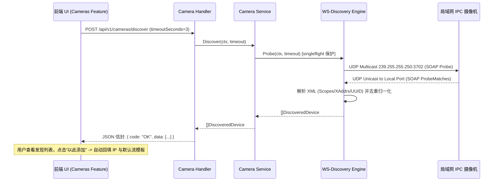

# Design: 2026-11-22-onvif-ws-discovery

## 架构与实现方案

### 1. 核心流程与数据流



### 2. 数据结构与模型设计

#### Go 后端模型 (`internal/camera/discovery/model.go`)

```go
package discovery

// Device 代表通过 WS-Discovery 发现的局域网摄像机设备。
type Device struct {
    ID               string   `json:"id"`               // EndpointReference UUID 或哈希唯一标识
    IP               string   `json:"ip"`               // 探测到的设备 IPv4 地址
    Port             int      `json:"port"`             // ONVIF HTTP 服务端口 (默认 80)
    XAddr            string   `json:"xAddr"`            // ONVIF Device Service 完整 URL
    Name             string   `json:"name"`             // 从 Scopes 解析出的设备名称 (onvif://www.onvif.org/name/...)
    Manufacturer     string   `json:"manufacturer"`     // 厂商 (Hikvision, Dahua, Uniview, etc.)
    Model            string   `json:"model"`            // 型号
    Hardware         string   `json:"hardware"`         // 硬件版本/架构
    Types            []string `json:"types"`            // ONVIF Types (如 NetworkVideoTransmitter)
    SuggestedRtspUrl string   `json:"suggestedRtspUrl"` // 基于常见厂商规则生成的推荐 RTSP 模板 (便于一键使用)
}

// DiscoverOptions 探测控制选项。
type DiscoverOptions struct {
    Timeout time.Duration // 扫描超时，默认 3s，上限 10s
    Interfaces []string   // 指定网卡，为空则自动枚举所有活动物理网卡
}
```

#### HTTP 请求与响应模型 (`internal/camera/requests.go` / `responses.go`)

```go
// DiscoverCamerasRequest 请求载荷。
type DiscoverCamerasRequest struct {
    TimeoutSeconds int `json:"timeoutSeconds" binding:"omitempty,min=1,max=10"`
}

// DiscoveredDeviceResponse 响应项。
type DiscoveredDeviceResponse struct {
    ID               string `json:"id"`
    IP               string `json:"ip"`
    Port             int    `json:"port"`
    XAddr            string `json:"xAddr"`
    Name             string `json:"name"`
    Manufacturer     string `json:"manufacturer"`
    Model            string `json:"model"`
    Hardware         string `json:"hardware"`
    SuggestedRtspUrl string `json:"suggestedRtspUrl"`
}
```

### 3. WS-Discovery 探测器实现细节 (`internal/camera/discovery/`)

1. **多播配置与发送**：
   - 组播地址：`239.255.255.250:3702` (IPv4 WS-Discovery)；
   - 探针构造：
     ```xml
     <?xml version="1.0" encoding="utf-8"?>
     <Envelope xmlns="http://www.w3.org/2003/05/soap-envelope"
               xmlns:wsa="http://schemas.xmlsoap.org/ws/2004/08/addressing"
               xmlns:d="http://schemas.xmlsoap.org/ws/2005/04/discovery"
               xmlns:dn="http://www.onvif.org/ver10/network/wsdl">
       <Header>
         <wsa:MessageID>uuid:{{.MessageID}}</wsa:MessageID>
         <wsa:To>urn:schemas-xmlsoap-org:ws:2005:04:discovery</wsa:To>
         <wsa:Action>http://schemas.xmlsoap.org/ws/2005/04/discovery/Probe</wsa:Action>
       </Header>
       <Body>
         <d:Probe>
           <d:Types>dn:NetworkVideoTransmitter</d:Types>
         </d:Probe>
       </Body>
     </Envelope>
     ```
2. **多网口自动遍历与隔离**：
   - 通过 `net.Interfaces()` 枚举所有处于 `net.FlagUp` 且非 `net.FlagLoopback` 的网络接口；
   - 过滤有效 IPv4 单播地址，分别绑定本地临时 UDP 端口发送组播探针，避免双网口（如工业主板的双千兆网口）下只从单一网卡发出导致另一物理网段漏探。
3. **安全读取与防挂死约束**：
   - 使用 `conn.SetDeadline(time.Now().Add(timeout))` 严格限定接收超时；
   - 循环 `conn.ReadFrom(buf)`，对每个应答包启动标准 XML 快速流式解析（或 DOM 反序列化）；
   - 超时截止时跳出循环，合并结果并去重。
4. **并发控制与防刷**：
   - 使用 `golang.org/x/sync/singleflight`（项目中现有或内联轻量 `singleflight.Group`），当多个会话并发请求发现时，共用单次 UDP 广播探测并共享结果；
   - 维护 5 秒 TTL 的内存短缓存，连续快速点击直接命中缓存，保护局域网网络稳定。

### 4. 前端组件设计 (`web/src/features/cameras/`)

1. **入口位置**：
   - 在 `CamerasPrimaryButtons`（摄像机列表顶部主按钮区）新增“发现设备”次级按钮（带有 `ScanSearch` 或 `Radar` 图标）；
   - 在 `CamerasActionDialog`（新增摄像机弹窗）的 RTSP URL 字段右侧或顶部增加“自动发现”轻量触发链。
2. **发现列表弹窗 (`CamerasDiscoverDialog.tsx`)**：
   - 包含“开始扫描 / 重新扫描”按钮、扫描倒计时进度与设备卡片/表格；
   - 展示字段：IP 地址、厂商徽标/文本（Hikvision、Dahua、Uniview、TP-Link、通用 ONVIF）、型号、服务地址；
   - 操作按钮：点击“导入 / 填入表单”，自动触发打开 `CamerasActionDialog` 并预填 `name`（设备名或型号）和 `mainRtspUrl`（形如 `rtsp://<ip>:554/...`）。

---

## 外部技术调研与参考

1. **ONVIF Application programmer's Guide - Discovery**:
   - 规范标准：*ONVIF Core Specification 2.0+ / WS-Discovery (OASIS standard)*.
   - 组播地址：`239.255.255.250`, 端口 `3702/udp`.
   - 消息协议：SOAP 1.2 over UDP.
   - 消息类型：`dn:NetworkVideoTransmitter` (NVT).
2. **Scope 解码规则**：
   - ONVIF 设备在 `ProbeMatches` 的 `Scopes` 字段以空格分隔的 URI 列表回传元数据：
     - `onvif://www.onvif.org/name/<URL-Encoded-Name>`
     - `onvif://www.onvif.org/hardware/<Model-String>`
     - `onvif://www.onvif.org/location/<Location-String>`
   - 解码时需对经过 URL 编码的中英文字符串执行 `url.PathUnescape`。
3. **常见厂商 RTSP 默认路径推断（辅助建议）**：
   - 海康威视 (Hikvision)：`rtsp://admin:password@<ip>:554/Streaming/Channels/101`
   - 大华/乐橙 (Dahua)：`rtsp://admin:password@<ip>:554/cam/realmonitor?channel=1&subtype=0`
   - 宇视 (Uniview)：`rtsp://admin:password@<ip>:554/unicast/c1/s0/live`
   - 通用格式：`rtsp://admin:password@<ip>:554/live/ch0`
   - 在前端提供厂商快速选择模板，避免用户手动拼写路径前缀。

---

## 风险与审查重点（Review Focus）

1. **多网口与虚拟网卡死锁/超时风险**：
   - 宿主机存在 Docker/Bridge/Tailscale/Wireguard 等虚拟网卡时，若向其发送组播可能立即返回错误或长时间阻塞。
   - *审查点*：探测器遍历网卡时是否正确跳过 Loopback、未启用的网卡，并对各网卡的发送/接收做严格上下文超时隔离，任一网卡报错不得阻断其它物理网卡的探测。
2. **恶意/畸形 XML 报文与内存保护**：
   - 局域网内可能存在非规范设备发送超大 UDP 载荷或畸形 XML（如 XML 炸弹或格式错误）。
   - *审查点*：读取 UDP 缓冲区限制固定大小（如 8KB~64KB），XML 解码器必须安全配置，遇到解析错误直接丢弃单条应答并记录 Debug 日志，禁止引起 panic。
3. **孤儿协程与资源泄漏**：
   - 探测生命周期结束时，打开的 UDP 连接、多播监听必须显式关闭。
   - *审查点*：`defer conn.Close()` 的执行时机，以及请求 context 被取消时能否在 100ms 内立即打断读超时退出。
4. **前端状态同步与防并发冲突**：
   - 扫描中关闭对话框或快速连续点击“重新扫描”。
   - *审查点*：TanStack Query / Mutation 的取消逻辑，以及在扫描中禁用重复触发按钮。
