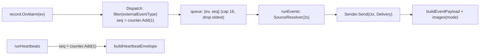

# Design: 2026-11-24-alertpush-payload-v1

## 架构与实现方案

### 1. v1 载荷契约（外部，snake_case）

#### 1.1 信封（所有消息共用）

| 字段 | 类型 | 规则 |
| --- | --- | --- |
| `schema_version` | int | 恒为 `1`。增量加字段不变；任何字段语义 / 类型 / 取值集合的破坏性变化必须升版本 |
| `id` | string | 事件取 `record` 记录 ID（重试不变，接收方据此去重）；心跳 / 离线每条新 ULID；LWT 在 `NewMQTTSender` 构造时生成 |
| `seq` | int \| null | 每个推送目标单调递增；事件入队时分配、心跳发送时分配，共用 `Dispatcher.counterFor(destID)`；LWT 为 `null`。进程重启后从 1 重新开始 |
| `event_type` | string | `alarm` \| `face` \| `vehicle` \| `heartbeat` \| `offline`，**等于唯一业务子对象的键名** |
| `device_id` | string \| null | `DeviceIDProvider` 每次发送实时读取，空串输出 `null` |
| `source` | object \| null | 仅感知事件（alarm/face/vehicle）有；心跳 / 离线为 `null` |
| `captured_at` | string \| null | 感知事件采集时间；心跳 / 离线为 `null` |
| `sent_at` | string \| null | 本次发送尝试时间（Webhook 每次重试重新构造）；LWT 为 `null` |
| `images` | array | 感知事件的可用图片列表；无图或非感知事件为 `[]`（**不为 null**） |
| `<event_type>` | object | 与 `event_type` 同名的业务子对象，其余类型的子对象**不出现** |

时间格式统一 `time.UTC` + 布局 `2006-01-02T15:04:05.000Z`（固定毫秒精度）。

`source`：

```json
{
  "camera": { "id": "01JC8F2H...", "name": "东门入口" },
  "algorithm": { "id": "ppe_helmet", "name": "安全帽检测", "version": "1.1.0" }
}
```

- `camera.name` / `algorithm` 由 `SourceResolver` 解析；摄像头查不到时 `name: null`；`AlgorithmID` 为空或查不到时 `algorithm: null`（`id` 存在但查询失败时输出 `{id, name:null, version:null}`）。
- `algorithm.version` 为**推送时已安装版本**（升级后不追溯），在文档中声明。

#### 1.2 业务子对象

```json
"alarm":   { "alarm_type": "no_helmet", "score": 0.94, "box": [0.32,0.15,0.45,0.38] | null, "attributes": {} }
"face":    { "matched": true, "person": { "id": "EMP_10086", "name": "张三" } | null,
             "similarity": 0.94 | null, "box": [...] | null, "attributes": {} }
"vehicle": { "plate": { "number": "粤BD12345", "color": "green" | null } | null,
             "vehicle_type": "suv" | null, "vehicle_color": "white" | null,
             "score": 0.985, "box": [...] | null, "attributes": { "plate_type": 5 } }
"heartbeat": { "status", "reasons", "host", "resources", "storage", "workload" }   // 原平铺字段整体下移
"offline":   { "reason": "connection_lost" | "graceful_shutdown" }
```

映射规则（`buildEventPayload`）：

- `box`：归一化 `[x1,y1,x2,y2]`，相对 `role=scene` 图；四元素全 0 视为「无框」输出 `null`。
- `alarm.attributes` 来自 `AlarmEventData.Extra`；`ev.Alarm == nil` 时回退旧扁平字段 `AlarmType/Score/Box/Extra`（record 仍在填充，本次不删除扁平字段）。
- `face.matched=false` 时 `person: null`、`similarity: null`；`matched=true` 且 `PersonID` 空时 `person.id: null`。
- `vehicle.plate`：`plate_number` 为空则 `plate: null`；外提键 `plate_number`、`plate_color`、`vehicle_type`、`vehicle_color` 从 `attributes` **拷贝后删除**（不修改 `ev` 原 map —— 事件值拷贝共享 map，必须先 `maps.Clone`）。
- 空字符串一律输出 `null`；`attributes` 恒为对象（nil → `{}`）。

#### 1.3 图片列表

```json
{ "role": "scene" | "object" | "reference", "mime": "image/jpeg", "size_bytes": 1843200,
  "url": string|null, "url_expires_at": string|null, "part": string|null, "base64": string|null }
```

- `size_bytes`：原图字节数，取自 `filestore.ObjectInfo.SizeBytes`，供接收方判断是否下载 4K 原图。multipart / base64 模式打开文件时顺带获得；url 模式下走本地签名 URL 时通过 `MediaReader.OpenContent` 取信息后立即关闭，走对象存储预签名（`MediaPresigner` 命中）时**不额外打开远端对象**，输出 `null`。

| role | 来源 | 条件 |
| --- | --- | --- |
| `scene` | `ev.ImagePath` | `ev.ImageReady && ImagePath != ""` |
| `object` | `ev.CropPath` | `ev.CropReady && CropPath != ""` |
| `reference` | `ev.Face.GalleryImagePath` | 仅 face 且非空 |

- 列表顺序固定 scene → object → reference；**某张图无法以任何方式提供时，不出现在列表中**（取代 `image_ready`）。
- **url 模式**：`resolveSignedOrPresignedURL` 成功则填 `url`，`url_expires_at = now + SignedURLTTL`；失败则该图不出现。
- **multipart 模式（Webhook）**：每张能打开的图写入 part `image_<role>`，载荷中 `part: "image_<role>"`；若配置了 `PublicBaseURL` 同时填 `url`（备用取图）。打开失败且无 url 时该图不出现。part 文件名 `<role>.jpg`。
- **base64 模式（MQTT）**：
  - **内联预算可配置**：MQTT 配置新增 `inline_max_kb`（API `config.inlineMaxKb`，存于 `config_json`，无需迁移），默认 `500`，允许 `64..8192`，按**原始字节**计（base64 编码后约 ×4/3，需小于 broker 单条消息上限：AWS IoT Core 128KB、Azure IoT Hub 256KB、EMQX 默认 `max_packet_size` 1MB、Mosquitto 默认不限）。取代常量 `maxMQTTBase64Bytes`。
  - **装入顺序 object → reference → scene**（小图优先、信息密度优先）：特写在 4K 下通常仅数十 KB，可稳定内联；4K 场景图（质量 85 约 1–3MB）一般超预算回退 url。注意**列表输出顺序仍为 scene → object → reference**，装入优先级只决定谁先占预算。
  - 单张超出剩余预算则不内联：配置了 `PublicBaseURL` 时仅带 `url`，否则该图不出现，并以 Warn 日志记录被省略的 `role` 与 `size_bytes`（不记录路径以外的敏感信息）。
  - 不强制 base64 模式配置 `public_base_url`（纯内网平台可能只需要特写），前端在 base64 选项下给出静态提示。
  - 原生缩略图（`scene_preview`，长边 ~1280）作为后续独立变更，本次不做。

#### 1.4 Webhook 请求头

`X-Zhulong-Event: <event_type>`、`X-Zhulong-Delivery: <id>`、`X-Zhulong-Schema: 1`。三者加入 `reservedHeaders`（小写比较），自定义 header 不可覆盖；已存储的同名自定义头在发送时被忽略（现有 `isReservedHeader` 过滤逻辑）。创建 / 更新时命中新保留头返回既有 `ErrReservedHeaderUsed`。

### 2. 代码结构

| 文件 | 改动 |
| --- | --- |
| `internal/alertpush/payload.go`（新） | v1 类型：`EventPayload`、`SourceInfo`/`CameraSourceInfo`/`AlgorithmSourceInfo`、`ImageInfo`、`AlarmInfo`、`FaceInfo`/`PersonInfo`、`VehicleInfo`/`PlateInfo`、`HeartbeatInfo`、`OfflineInfo`；常量 `SchemaVersion = 1`、`EventTypeAlarm/Face/Vehicle`、`ImageRoleScene/Object/Reference`；`formatPayloadTime`、`externalEventType(record.EventType) string`；`buildEventPayload`、`buildHeartbeatEnvelope`、`buildOfflineEnvelope` |
| `internal/alertpush/sender.go` | 删除旧 `AlarmPayload`/`HeartbeatPayload`/`*DataPayload`/`mqttOffline*Payload`；`Sender.Send` 签名改为 `Send(ctx, d Delivery) error`；新增 `Delivery{Event record.AlarmEvent; Seq uint64; Source SourceInfo}`；`SourceResolver` 接口；`populateSignedURLs` 改为按 role 产出 `[]ImageInfo` 的 `resolveImageURLs` |
| `internal/alertpush/dispatcher.go` | 队列元素改为 `queuedEvent{ev, seq}`；`Dispatch` 在匹配目标后 `counterFor(id).Add(1)` 再入队（溢出丢弃的旧元素序号成为缺口）；`runEvents` 出队后调用 `SourceResolver` 构造 `Delivery`；`Config` 增加 `Source SourceResolver` |
| `internal/alertpush/sender_webhook.go` | JSON / multipart 按 1.3 构造，multipart 写多 part；设置 1.4 请求头；心跳 / 测试探针同样带头 |
| `internal/alertpush/model.go` / `requests.go` / `responses.go` / `handler.go` | `mqttConfig.InlineMaxKB`（`json:"inline_max_kb,omitempty"`，0 视为默认 500）；`AlertDestinationConfigInfo.InlineMaxKB *int`（`json:"inlineMaxKb,omitempty"`）创建 / 更新 / 测试 / 响应透传；越界返回 422 `ALERT_DESTINATION_CONFIG_INVALID` |
| `internal/alertpush/sender_mqtt.go` | `MQTTSenderOptions.InlineMaxBytes`；base64 按 object → reference → scene 装入预算；LWT / 优雅离线改用 `buildOfflineEnvelope` |
| `internal/alertpush/filter.go` / `service.go` / `handler.go` / `locale.go` | 过滤器 `event_types` 白名单 `alarm|face|vehicle`，非法值返回 422 + 新稳定码 `ALERT_DESTINATION_EVENT_TYPE_INVALID`（三语文案）；`Matches` 用 `externalEventType(ev.EventType)` 比较 |
| `internal/alertpush/service.go` | `sendTestProbe` 构造 `Delivery`（`Alarm` 子数据、`Seq: 0`、`Source` 用固定 `test_cam`/`null` 算法） |
| `internal/app/adapters.go` / `app.go` | 新增 `alertSourceResolver{cameras *camera.CameraService; algorithms *algorithm.Service}` 实现 `SourceResolver`，在 `provideAlertPush` 注入 `Config.Source` |
| `internal/database/migrations/000040_alert_filter_event_type_v1.{up,down}.sql` | up：以 `json_each` + `json_set` **仅改写 `$.event_types` 数组**（`face_recognition`→`face`、`plate_recognition`→`vehicle`），`algorithm_ids`/`camera_ids` 中的同名字符串不受影响；down 反向。（实施时由 `replace()` 收紧为 JSON 路径改写，避免误伤 ID） |
| 前端 `destination-filters-section.tsx` / `inline-budget-field.tsx`（新）/ `data/schema.ts` / `api/alert-push-api.ts` / `types/index.ts` + 三语 `locales` | 过滤选项 `type` 改为 `face`/`vehicle`，文案键同步重命名；「内联图片上限 (KB)」字段紧随「图片附带模式」下拉框，仅 MQTT + base64 时显示（Zod 校验 64..8192，默认 500）并附 broker 上限说明；`RESERVED_HEADERS` 补充 `x-zhulong-*`；`base64Desc` 说明「小图优先内联，超限图片以 URL 提供（需配置 `[alertpush].public_base_url`），否则省略」。（实施时由 `mqtt-config-section.tsx` 移至图片模式旁：该区块随协议切换同轮挂载，`useWatch` 会读到旧的 imageMode） |

`SourceResolver`（消费侧声明，alertpush 不 import camera/algorithm）：

```go
type SourceResolver interface {
    ResolveSource(ctx context.Context, cameraID, algorithmID string) SourceInfo
}
```

- 实现不得返回 error：查询失败在实现内记 Debug 日志并降级为 null 字段，保证推送不因元数据查询失败而丢失。
- 调用在 worker 协程内、使用独立 `context.WithTimeout(context.Background(), 2s)`，**不在 `Dispatch` 热路径（持 `d.mu.RLock`）调用**。
- nil resolver（单测 / 部分装配）时 `source.camera = {id, name:null}`、`algorithm = {id,...}|null`。

### 3. 数据流



## 外部技术调研与参考

无新增依赖。字段设计参考（仅借鉴结构，不实现其协议）：

- 海康 ISAPI `EventNotificationAlert`：`activePostCount` 递增序号 → `seq`；`channelID` + `channelName` → `source.camera{id,name}`。
- NVIDIA DeepStream `nvmsgconv` full schema：`mdsversion` → `schema_version`；`sensor` / `analyticsModule` → `source.camera` / `source.algorithm`。
- GA/T 1400 `SubImageList` / `SubImageInfoObject.Type`：带类型图片列表 → `images[].role`。
- Frigate `frigate/events`（`new/update/end`）：生命周期设计留作后续增量字段，本次不实现。
- SQLite `replace(X,Y,Z)` 为核心标量函数，无需 JSON1 扩展。

## 风险与审查重点（Review Focus）

1. **seq 缺口语义**：`Dispatch` 必须在入队前分配 seq，溢出被挤掉的旧事件序号永久缺失；同一事件的 Webhook 重试复用同一 `seq` 与 `id`，仅 `sent_at` 变化。心跳与事件共用计数器且并发 `Add`，不得出现重复 seq。
2. **共享 map 污染**：`AlarmEvent` 是值拷贝但 `Attributes`/`Extra` map 共享，多个目标并发构造载荷时若原地删除外提键会产生数据竞争；必须 `maps.Clone` 后修改，`-race` 用例需覆盖多目标并发发送同一事件。
3. **图片可用性一致性**：三种模式下同一事件的 `images` 角色集合规则（url 失败 / 文件打开失败 / base64 超预算）；multipart 打开的多个文件句柄在任一错误路径都必须关闭。base64 装入优先级（object → reference → scene）与列表输出顺序（scene → object → reference）是两回事，不得混淆；预算按原始字节计且读取用 `io.LimitReader(剩余预算+1)` 防止文件在 stat 与读取之间变大。
4. **Dispatch 热路径**：`SourceResolver` 不能在持 `d.mu.RLock` 的 `Dispatch` 中调用；resolver 超时不能阻塞 worker 停机（独立 2s ctx，停机排空沿用 3s deadline）。
5. **迁移与校验**：000040 只改写 `filter_json` 中的精确 JSON 字符串字面量（带引号），up/down 对称；服务端白名单校验后，旧名提交返回 422 而非静默丢弃过滤条件（静默丢弃会让过滤器变为「全部匹配」）。
