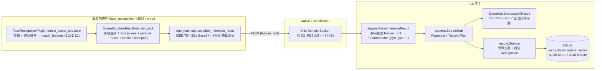

# 技术设计：流式人脸推理回传特征向量与识别记录持久化

## 1. 全链路架构与分层边界



### 核心不变量
1. **单一二进制特征格式**：全系统持久化层（`person_faces.feature_vector` 与新增 `recognitions.feature_vector`）及 IPC 原始字节载荷统一采用 **512 个 IEEE-754 小端 `float32`（`2048` 字节）**，且必须为全部元素有限、L2 单位归一化的向量，后续与 `person_faces` 做余弦内积或一键转入底库**零格式转换**。
2. **单次分配、单次释放（Contiguous Arena）**：C++ 侧不引入二次堆分配或子指针独立 `free`；特征池紧随 `zhulong_face_candidate[]` 置于同一 Arena 尾部，由 `result_release` 一次 `std::free` 释放。
3. **对外 JSON 零泄漏**：`aitypes.FaceStructureItem.FeatureVector` 与 `FaceSubItem.FeatureVector` 标记 `json:"-"`，`record.RecognitionResponse` 与 `record.FaceEventData` 不映射该字段，从类型系统根源阻断实时预览流、单图试跑、HTTP 列表与 Webhook 泄漏 2 KB 向量。

---

## 2. Native SDK 与 C ABI 设计

### 2.1 `plugin.h` 零尺寸膨胀布局

复用 `SCENE_STRUCTURE v2` 预留的对齐槽位，使两个核心 C ABI 结构体尺寸与既有字段偏移 **100% 保持不变**：

```c
#define ZHULONG_FACE_FEATURE_MAX_DIM 512

typedef struct zhulong_face_structure_item {
    float    box[4];                                   /*   0..16  */
    float    quality;                                  /*  16..20  */
    float    landmarks[ZHULONG_FACE_LANDMARK_COUNT][2];/*  20..60  */
    int32_t  matched;                                 /*  60..64  */
    float    similarity;                               /*  64..68  */
    int32_t  is_fused;                                /*  68..72  */
    int32_t  person_index;                             /*  72..76  */
    char     person_id[ZHULONG_PERSON_ID_MAX_LEN];      /*  76..140 */
    char     person_name[ZHULONG_PERSON_NAME_MAX_LEN];  /* 140..204 */
    char     matched_face_id[ZHULONG_FACE_ID_MAX_LEN];  /* 204..268 */
    uint32_t candidate_count;                          /* 268..272 */
    uint32_t feature_offset;                           /* 272..276: scene->face_features 中的起始 float 下标 */
    uint32_t feature_dim;                              /* 276..280: 特征维度 (无特征时为 0) */
    const zhulong_face_candidate* candidates;          /* 280..288 */
} zhulong_face_structure_item;                         /* 恒为 288 字节，8 字节对齐 */

typedef struct zhulong_scene_structure {
    uint32_t person_count;                             /*  0..4  */
    uint32_t face_count;                               /*  4..8  */
    const zhulong_person_item* persons;                /*  8..16 */
    const zhulong_face_structure_item* faces;          /* 16..24 */
    const float* face_features;                        /* 24..32: 连续特征浮点池首地址 (全帧无特征时为 NULL) */
} zhulong_scene_structure;                             /* 恒为 32 字节，8 字节对齐 */
```

- **向后兼容性质**：任何按旧规范 `memset(&scene, 0, sizeof(scene))` / `memset(&face, 0, sizeof(face))` 构造的数据天然满足 `face_features == NULL, feature_offset == 0, feature_dim == 0`。
- **对齐验证**：前四段尺寸分别为 `32`、`40 * n_persons`、`288 * n_faces`、`200 * n_candidates`，全部是 `8` 的整数倍；因此紧随其后的 `float face_features[]` 起始地址天然满足 **8 字节对齐**（高于 `alignof(float) == 4`）。

### 2.2 `SceneStructureResultAdapter::pack`（`native/sdk/include/zhulong/algo.hpp`）

- `zhulong::FaceItem` 与 `zhulong::FaceStructureItem` 各增加 `std::vector<float> features;`（默认空）。
- 打包前校验每张脸的 `features`：
  ```cpp
  static bool is_packable_feature(const std::vector<float>& feat) noexcept {
      if (feat.empty() || feat.size() > ZHULONG_FACE_FEATURE_MAX_DIM) {
          return false;
      }
      for (float v : feat) {
          if (!std::isfinite(v)) {
              return false;
          }
      }
      return true;
  }
  ```
- 仅对 `is_packable_feature(f.features) == true` 的人脸累加 `n_feature_floats`（带 `size_t` 乘法/加法溢出保护，溢出抛 `std::length_error` 由 `PluginApi` 异常防爆门转为 `ZHULONG_PLUGIN_ERR_OUT_OF_MEMORY` / `INTERNAL`）；不合法的特征置 `dst_f.feature_offset = 0, dst_f.feature_dim = 0`。
- 当 `n_feature_floats > 0` 时，`out_scene->face_features = reinterpret_cast<float*>(arena + scene_bytes + persons_bytes + faces_bytes + candidates_bytes)`，按序 `std::memcpy` 拷入并记录各自 `feature_offset` 与 `feature_dim`；当 `n_feature_floats == 0` 时，`out_scene->face_features = nullptr`。

### 2.3 算法包特征填充（`packages/face_recognition/{rk3568,onnx}`）

- 在 `FaceRecognitionPlugin::populate_matched_face_item` 中，`match_features` 已经通过了 `fused_outputs[i].valid`（有限且 L2 单位化）校验并完成了 `matcher_.match` 与 `should_emit_face_result` 门禁：
  ```cpp
  out_face.features.assign(match_features.begin(), match_features.end());
  ```
- 在 `detect_scene_structure` 组装 `zhulong::FaceStructureItem` 时：`face.features = std::move(processed.item.features);`；在兼容方法 `detect_persons` 中同步 `fi.features = std::move(f.features);`。
- 两个档位的 `CMakeLists.txt` 同步更新 `find_package(ZhulongAlgoSDK 1.3 REQUIRED)`，消除旧 SDK 前缀误编隐患。

---

## 3. Runner IPC 序列化与 64 KB 预算裁剪（`native/sdk/src/algo_main.cpp`）

### 3.1 方案对比

| 编码格式 | 512 维单脸体积 | 浮点精度 | 序列化 CPU 开销 | 64 KB 单帧容纳人脸上限 |
| :--- | :--- | :--- | :--- | :--- |
| 十进制 JSON 数组 `[0.0123456,...]` | ~4 600–5 200 B | 默认 `ostringstream` 仅 6 位有效数字，有损 | 512 次 `dtoa` 格式化，较慢 | ~11 张（超限整帧丢失） |
| **小端 IEEE-754 字节流 + Base64（选用）** | **固定 2 732 B**（含键名 `2 749` B） | **32-bit 逐位无损** | 查表位运算，极快 | **~20 张**（配合预算裁剪永不丢帧） |

### 3.2 精确到字节的 64 KB 预算保护算法

`ipc::MAX_IPC_PAYLOAD_SIZE = 65536` 是 `unix_socket.cpp` 的硬拒绝线。在 `serialize_inference_result` 的 `ZHULONG_RESULT_TYPE_SCENE_STRUCTURE` 分支中：

1. 为每张人脸先构建**不含特征**的基础 JSON 片段 `face_meta_json[i]`（含 `box`、`quality`、`landmarks`、`matched`、`similarity`、`person_index`、`person_id`、`person_name`、`matched_face_id`、`candidates`，不含末尾 `}`）。
2. 若 `scene->face_features != nullptr && f.feature_dim > 0 && f.feature_dim <= ZHULONG_FACE_FEATURE_MAX_DIM`，将该脸 `f.feature_dim` 个 `float` 按显式小端字节序编码为 Base64，生成扩展片段 `face_feat_ext[i] = ",\"feature_b64\":\"" + b64 + "\""`（512 维时固定 `2749` 字节）；任一元素非有限则置空。
3. 计算基础总长 `base_bytes` = 头部 + `persons` 数组 + 所有 `face_meta_json[i]` + 分隔逗号 + 闭合括号 `}`/`]}`。
4. 若 `base_bytes + sum(face_feat_ext[i].size()) <= ipc::MAX_IPC_PAYLOAD_SIZE`（常规 1~20 人场景 100% 走此快路径），全部人脸均附加 `face_feat_ext[i]`。
5. 若超出 `MAX_IPC_PAYLOAD_SIZE`（极端密集人群 `> 20` 张脸）：
   - 若 `base_bytes < ipc::MAX_IPC_PAYLOAD_SIZE`，设 `remaining = ipc::MAX_IPC_PAYLOAD_SIZE - base_bytes`，按 `(f.quality desc, i asc)` 排序索引依次扣减预算并标记允许携带特征的人脸；预算不足的尾部人脸仅输出 `face_meta_json[i] + "}"`，保证**最终 JSON 字节数严格 `<= 65536`**，整帧结构化结果绝不因特征字段被 socket 层拒发。

---

## 4. Go 宿主解析、实时隔离与 SQLite 持久化

### 4.1 `internal/aitypes` 反序列化与安全门禁

- 常量：`FaceFeatureDimension = 512`，`FaceFeatureByteLen = FaceFeatureDimension * 4`（`2048`）。
- 领域类型（对外/跨包共享）：
  - `FaceStructureItem` 与 `FaceSubItem` 新增 `FeatureVector []byte` `json:"-"`。
- Wire 解码类型（包内私有，仅 `ParseInferenceResult` 使用）：
  - `rawFaceStructureItem` 嵌入/同构现有 JSON 字段并额外声明 `FeatureB64 string` `json:"feature_b64,omitempty"`（同理兼容 `rawPersonItem` 如有需要，当前主流路径为 `scene_structure`）。
- `decodeFaceFeatureB64(raw string) []byte` 校验链：
  1. `raw == ""` → 返回 `nil`。
  2. `base64.StdEncoding.DecodeString(raw)` 失败或 `len(buf) != FaceFeatureByteLen`（`2048`）→ 返回 `nil`。
  3. 逐 4 字节按 `binary.LittleEndian.Uint32` 转 `math.Float32frombits`：若存在 `math.IsNaN` / `math.IsInf`，或累计范数平方 `normSq <= 1e-12`（全零/退化向量）→ 返回 `nil`。
  4. 校验通过返回 `buf`（只丢弃坏向量，绝不丢弃合法识别记录）。

### 4.2 数据库迁移与 `internal/record` 读写分层

- **迁移 `000034_add_feature_vector_to_recognitions`**：
  ```sql
  -- 000034_add_feature_vector_to_recognitions.up.sql
  ALTER TABLE recognitions ADD COLUMN feature_vector BLOB;

  -- 000034_add_feature_vector_to_recognitions.down.sql
  ALTER TABLE recognitions DROP COLUMN feature_vector;
  ```
  - 可空 `BLOB` 列在 SQLite 中属于纯 Schema 头部追加（O(1)，不重写既有数据页）；旧行与无特征算法写入 `NULL`（磁盘开销 1 字节类型头）。
- **`record.Recognition` 模型与构建**：
  - `FeatureVector []byte` `gorm:"column:feature_vector"`。
  - `buildRecognitionRecordAndJob`：当 `len(face.FeatureVector) == aitypes.FaceFeatureByteLen` 时拷贝/引用赋给 `rec.FeatureVector`，否则赋 `nil`（GORM 写入 SQL `NULL`）。
- **分页列表溢出页隔离（`Store.ListRecognitions`）**：
  - SQLite 默认页大小 `4096` B，单行含 `2048` B `BLOB` 加若干路径/JSON 列时，部分列可能落入 overflow page。
  - 在 `listInReadSnapshot` 中增加可选的读取列排除参数（或在 `Find` 链上支持 `Omit`），使 `ListRecognitions` 在 `Count(ctx, "*")` 之后对 `Find(ctx)` 执行 `.Omit("feature_vector")`：
    - `COUNT(*)` 与索引扫描 `(camera_id, captured_at DESC, id DESC)` / `(captured_at DESC, id DESC)` 完全不受影响（不产生 `TEMP B-TREE`）；
    - 常规列表浏览、CSV/ZIP 导出无需把每页 `N * 2 KB` 的二进制向量读入 Go 堆内存；
    - `GetRecognitionByID` 保持全列读取（返回完整 `FeatureVector`），供详情核验与单测断言使用，后续陌生人聚类/检索任务可在 `Store` 按需增加专用向量投影查询（类似 `person.Store.ListSearchFaceItemsPaged`）。

---

## 5. 兼容性、风险与回滚策略

| 维度 | 兼容性与保护设计 |
| :--- | :--- |
| **旧算法包 → 新宿主** | 旧包 IPC JSON 不含 `"feature_b64"` → Go 解析得 `FeatureVector = nil` → `recognitions.feature_vector` 写 `NULL`，功能 100% 兼容。 |
| **新算法包 → 旧宿主** | 旧宿主 `json.Unmarshal` 默认忽略未知键 `"feature_b64"`，且 64 KB 预算守卫保证旧宿主 IPC 接收不断链。 |
| **实时流 / Swagger / 前端** | `FeatureVector` 标记 `json:"-"` 且不进入 `RecognitionResponse`，OpenAPI 文档（`make api-docs`）与前端 Zod Schema 零改动兼容。 |
| **回滚路径** | 数据库支持 `000034.down.sql`（`DROP COLUMN feature_vector`）；代码层回滚 `abi.json` + SDK + 包 + Go 提交批次即可完整还原。 |
