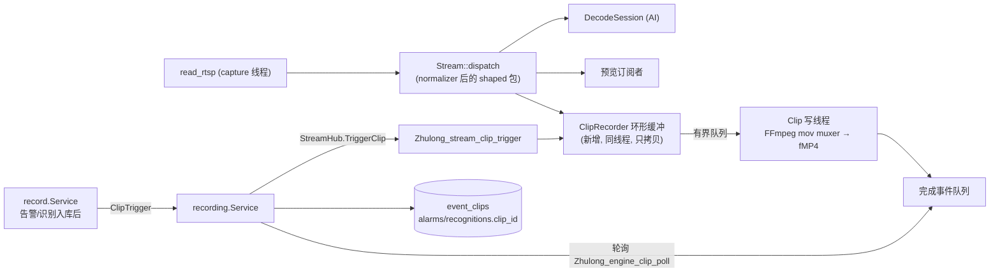

# Design: 事件录像片段

## 1. 总体数据流



## 2. Native（C++）

### 2.1 ClipRecorder（`native/src/pipeline/clip_recorder.{hpp,cpp}`，新增）

- 每个 `Stream` 至多一个，由 `Stream` 持有（`std::unique_ptr`），只有调用 configure ABI 后才创建。
- **接入点**：`Stream::dispatch`（stream.cpp:724-783），normalizer 之后、fan-out 之前（与 DecodeSession / 订阅者并列）。只录 `track_type == VIDEO`。
  - ⚠️ `dispatch` 在「无 session 且无订阅者」时提前返回（normalizer 不跑）。这个判断要加上「或 recorder 存在」。实际上 recorder 只在 AI 流上配置，session 必然存在，但条件仍要写对。
  - shaped 包的 data 借用 normalizer 缓冲，只在本次 dispatch 内有效，进入环形缓冲时必须深拷贝（`std::vector<uint8_t>` / 池化块）。
- **环形缓冲**：按 GOP 组织的 `deque<Gop>`，`Gop{ vector<Pkt> }`，`Pkt{pts_us, dts_us, key, bytes}`。
  - 淘汰：保留覆盖 `pre_ms` 所需的最少 GOP（最老 GOP 的起点 ≤ 最新包 − pre_ms），同时总字节 ≤ `byte_cap`；超上限时从最老 GOP 整组淘汰，保证首包永远是关键帧。
  - `gop_id` 跳变（时间轴不连续 / 重连）时清空缓冲；正在录的片段在此处结束，标 `truncated`。
- **片段状态机**（每个 recorder 同时只有 0 或 1 个 active clip）：
  - `trigger(event_pts_us, post_ms, max_ms, path)`：
    - 有 active clip 且 `event_pts_us + post_ms − clip_start ≤ max_ms` → 延长 `end_pts = max(end, event+post)`，返回 `{seq, created=false, offset_ms}`；
    - 有 active clip 但超长 → 先在下一个关键帧处结束旧片段（不再延长），再新建；
    - 新建：在缓冲里选起点 GOP（最后一个起点 ≤ event−pre 的 GOP；缓冲不足就取最老 GOP），把起点到当前的所有包一次性入写队列，之后的实时包持续入队，直到 `pts_us ≥ end_pts`（结束于包边界，不要求以关键帧结束）。
    - `event_pts_us ≤ 0`（Go 拿不到 pts_us）→ 以最新包 pts 作为事件时刻。
    - `offset_ms = (event_pts_us − clip_first_pts_us)/1000`。
  - `pre_ms` 由 configure 设置（相机内各任务前段的最大值）；`post_ms` / `max_ms` 由每次 trigger 传入。
- **写线程**：每个 recorder 一个 `std::thread`，有界队列（默认 ≤ 16 MiB 或 1024 包）。capture 线程只做非阻塞 `try_push`；**失败即置 truncated**，丢弃该片段后续所有包（写线程收尾即可）。capture 线程绝不等待写线程（R4.1）。
- **Muxer**：`native/src/nodes/record/fmp4_writer.{hpp,cpp}`（新增节点目录）。
  - `avformat_alloc_output_context2(..., "mp4", path)`，`movflags=frag_keyframe+empty_moov+default_base_moof`，time_base 1/1000000，用 dts_us/pts_us 重基到首包。
  - extradata：取片段首个关键帧里 normalizer 注入的 Annex B 参数集（SPS/PPS[/VPS]）作为 `codecpar->extradata`；mov muxer 会把 Annex B 自动转成 avcC/hvcC。**实现时用单测验证 H.264 与 HEVC 两种情况**；不行的话启用 `extract_extradata` bsf 作为退路。
  - 先写 `path + ".part"`，结束后 `rename` 成 `path`，避免半个文件被当成完成品。崩溃后残留的 `.part` 由 Go 启动修正处理（§3.5）。
  - 任何 FFmpeg 错误 → 片段 `failed`，删除 `.part`。
- **完成事件**：写线程结束片段后，把 `{seq, status, first_pts_us, last_pts_us, duration_ms, size_bytes, codec}` 推入 engine 级的有界完成队列（溢出时丢最旧的；Go 启动修正兜底）。
- **生命周期**：recorder 析构（stream retire / `engine_destroy`）时，停止接收新包，让 active clip 以 `completed` 收尾（写到当前为止，`partial` 由时长 < 期望值体现），然后 join 写线程。析构有上限（例如 3s），超时则放弃并 detach-safe 地标 `truncated`。

### 2.2 C ABI（`engine.h`，`ZHULONG_ABI_VERSION` 6 → **7**）

```c
/* v7: 事件录像片段 */
typedef struct {
    int64_t pre_ms;          /* 0 = 关闭并释放缓冲；>0 时设置前段保留时长 */
    int64_t byte_cap;        /* 环形缓冲字节上限，<=0 用默认 32 MiB */
    int64_t queue_byte_cap;  /* 写队列上限，<=0 用默认 16 MiB */
    uint32_t reserved[4];
} Zhulong_recorder_config;

Zhulong_status_t Zhulong_stream_recorder_configure(Zhulong_engine_h, Zhulong_stream_id,
    const Zhulong_recorder_config *cfg);

typedef struct {
    int64_t event_pts_us;    /* <=0: 取最新包 */
    int64_t post_ms;
    int64_t max_ms;          /* 单片段上限，<=0 默认 120000 */
    const char *path;        /* 绝对路径，UTF-8，native 拷贝 */
    uint32_t track_mask;     /* 预留音频，v7 只接受 VIDEO */
    uint32_t reserved[3];
} Zhulong_clip_trigger_request;

typedef struct {
    uint64_t clip_seq;       /* engine 内单调递增 */
    int32_t created;         /* 1 = 新片段（使用了本次 path）；0 = 延长已有片段 */
    int32_t codec;
    int64_t offset_ms;
    int64_t start_pts_us;
} Zhulong_clip_trigger_result;

Zhulong_status_t Zhulong_stream_clip_trigger(Zhulong_engine_h, Zhulong_stream_id,
    const Zhulong_clip_trigger_request *req, Zhulong_clip_trigger_result *out);

enum { ZHULONG_CLIP_COMPLETED = 1, ZHULONG_CLIP_TRUNCATED = 2, ZHULONG_CLIP_FAILED = 3 };
typedef struct {
    uint64_t clip_seq;
    int32_t status;
    int32_t codec;
    int64_t duration_ms;
    int64_t size_bytes;
    int64_t first_pts_us, last_pts_us;
    uint32_t reserved[4];
} Zhulong_clip_event;

/* caller-buffer：最多取出 capacity 条并出队；*out_count 为实际条数 */
Zhulong_status_t Zhulong_engine_clip_poll(Zhulong_engine_h, Zhulong_clip_event *buf,
    int32_t capacity, int32_t *out_count);
```

- 错误码：recorder 未配置 → `NOT_READY`；缓冲为空（流刚起）→ `NOT_READY`；路径非法 → `INVALID_ARGUMENT`。不新增状态码（若确实需要，Go 侧补对应 sentinel 与 `TestSentinelCodesAreUnique`）。
- 全部经 `boundary()` 隔离异常；out 参数先置零；不持有任何 Go 指针（path 立即拷贝）。
- 选用**轮询**而不是回调：完成事件低频（秒级），轮询避免了回调线程与 `in_callback` 约束，Go 侧也更简单。
- 与 Q3 的偏差说明：recorder 直接挂在 AI 已 acquire 的 Stream 上，**不另做 `CONSUMER_RECORDING` acquire**，因为 Q4 已确定「只在 AI 流存在时录」，再 acquire 一次只会延长流的生命。`CONSUMER_RECORDING` 继续保留给将来的连续录像。

### 2.3 FFmpeg 构建（`native/scripts/build.py`）

- FLAGS 追加 `--enable-muxer=mp4 --enable-protocol=file`，以及 `--enable-demuxer=mov`（只给 native 自测读回校验用，体积很小）。按需追加 `--enable-bsf=extract_extradata`（见 2.1 的退路）。
- 都是 LGPL 组件，不碰 gpl/nonfree。改 FLAGS 会自动改变缓存 key，需要 `make native-deps`（唯一联网步骤）重建；交叉 profile 同样要重建。

## 3. Go

### 3.1 `internal/engine`（唯一 cgo 包）

- 新文件 `clip.go`：`(*Stream).ConfigureRecorder(ctx, RecorderConfig)`、`(*Stream).TriggerClip(ctx, ClipTriggerRequest) (ClipTriggerResult, error)`、`(*Engine).PollClipEvents(ctx, max int) ([]ClipEvent, error)`。按 cgo-contract 用 `Stream.lease(ctx)` / `borrowHandle`，cgo 调用期间不持 `mu`。
- `expectedABIVersion` 自动跟随头文件变为 7。

### 3.2 `internal/camera`

- `MediaStream` 接口新增 `ConfigureRecorder` / `TriggerClip`（`EngineMediaAdapter` 实现，测试桩同步更新）。
- `StreamHub`：
  - `SetClipPolicyProvider(p)`：`p.RecorderFor(cameraID) (preMs int64, enabled bool)`。
  - AI 流 acquire 成功后（`acquireAIStreamBrokerPath` 末尾）应用 recorder 配置；新增 `RefreshRecorders(ctx)`：遍历 `aiStreams` 重新应用（任务变化时调用）。
  - `TriggerClip(ctx, cameraID, req)`：与 `Snapshot` 同样的模式，AI 流不活跃时返回 `ErrAIStreamInactive`。

### 3.3 `internal/task`

- 迁移给 `task_algorithms` 新增 `clip_config_json TEXT NOT NULL DEFAULT '{}'`。
- `ClipConfig{Enabled bool; PreSeconds int; PostSeconds int; RecognitionFilter string("all"|"stranger"|"known")}`，`ParseClipConfig` 负责校验和默认值（空串或 `{}` 视为关闭）→ apperr `INVALID_CLIP_CONFIG`（locale 中英）。
- requests/responses 增加 `clipConfigJson`（同 `regionConfigJson` 的处理方式，`sameTaskSemantics` 纳入比较）。
- `ClipPolicyCache`（同 `RegionConfigCache` 的模式，实现 `TaskChangeListener`）：
  - `PolicyFor(cameraID, algorithmID) (ClipConfig, bool)`：给 record 用；
  - `RecorderFor(cameraID) (preMs, enabled)`：取该相机所有启用任务前段的最大值；
  - Reload 后回调 `StreamHub.RefreshRecorders`（在 app 层接线，task 包不依赖 camera）。

### 3.4 `internal/recording`（新包，纯构造 + lifecycleRuntime）

- `Store`（依赖 `database.DBProvider`）：event_clips 的增删改查、`AttachClip(table, eventID, clipID, offsetMs)`、`RecordingClips()`、`FinishedClipsOlderThan`。
- `Service`：
  - `Trigger(ctx, TriggerRequest{CameraID, AlgorithmID, EventKind(alarm|recognition), EventID, PTSUS *int64, CapturedAt, Policy ClipConfig}) (clipID string, offsetMs int64, err error)`：
    1. 检查写门 `CanWrite()`，失败返回 `ErrClipSkipped`；
    2. 现取媒体根，生成新的 `clipID = idutil.New()` 和路径 `recordings/{camera}/{YYYY-MM-DD}/evt-{clipID}.mp4`（日期按 capturedAt 的 UTC），`MkdirAll`；
    3. 调 `hub.TriggerClip`；`created=true` → 插入 event_clips（status=recording），并记录 `seq→clipID`；`created=false` → 按 seq 查已有 clipID（找不到时说明进程内状态丢失，返回错误，事件不关联）；
    4. 回填事件行的 `clip_id` / `clip_offset_ms`；
    5. `EventKind==alarm` → 在片段文件旁写 `.lock`（`{path}.lock`，幂等；`.part` 阶段的文件也由 activeFileGrace 2min 保护）。
  - 轮询循环（500ms）：`PollClipEvents` → 更新 status/duration/size/ended_at，从 `seq→clipID` 中移除；`failed` 的行保留（status=failed，前端显示「录像失败」），文件已由 native 删掉。
  - `Start`：修正残留 recording 行：`{path}` 存在 → completed+partial（size 取文件大小）；只有 `{path}.part` → 先 rename 再按 partial 处理（fMP4 的已写分片可播放）；都不存在 → failed。然后启动轮询与清理。
  - `Stop`：停止轮询前做最后一次 poll；剩余的交给下次启动修正。
  - 清理（每 10 分钟）：status ≠ recording 且文件不存在的 event_clips 行 → 删除（FK `ON DELETE SET NULL` 自动清掉事件上的引用）。片段行状态已确定才删，所以不存在「扫描误删正在写的文件」的问题（record 规范担心的场景不适用）；failed 行超过 RecordingsRetentionDays 后也删除。
  - HTTP：首期**不**新增独立端点；片段信息随告警/识别响应返回（`ClipInfo` 投影）。因此不需要进 `api-docs` 白名单（如需要 `GET /clips/:id` 再补）。
- `record` 只依赖窄接口 `ClipTrigger`（定义在 record 包内），由 app 层注入 `recording.Service`；未注入时视为关闭。

### 3.5 `internal/record` 改动

- `processPersonStructure` / `processDetection` / `processClassification`：在 `Create*Batch` 成功、`dispatchCreated` 之前（或并行），对每条新记录按 `ClipPolicyCache.PolicyFor(camera, algorithm)` 判断是否触发（识别还要看 `matched` 与 filter），同步调用 `ClipTrigger.Trigger`。
  - 同一批里多条记录：依次触发；native 会合并到同一片段，代价很小（只是加锁和改 end）。
  - 失败只记 Warn，不影响返回值和事件分发（R4.3）。
  - 事件广播的 payload 首期不带 clip（Q14）。
- model：`Alarm` / `Recognition` 增加 `ClipID *string`、`ClipOffsetMS *int64`；List/Get 查询 `LEFT JOIN event_clips` 或批量二次查询（建议二次查询：`clip_id IN (...)`，避免改动现有分页 SQL），装配 `ClipInfo{ID, Status, Partial, DurationMS, OffsetMS, MediaPath, Codec}`。
- `ListRecognitions` 维持 `.Omit("feature_vector")`。

### 3.6 迁移 `000038_create_event_clips`

```sql
CREATE TABLE event_clips (
  id TEXT PRIMARY KEY,
  camera_id TEXT NOT NULL,
  path TEXT NOT NULL,
  codec TEXT NOT NULL DEFAULT '',
  status TEXT NOT NULL CHECK (status IN ('recording','completed','truncated','failed')),
  partial INTEGER NOT NULL DEFAULT 0,
  started_at DATETIME NOT NULL,
  ended_at DATETIME,
  duration_ms INTEGER NOT NULL DEFAULT 0,
  size_bytes INTEGER NOT NULL DEFAULT 0,
  created_at DATETIME NOT NULL DEFAULT CURRENT_TIMESTAMP
);
CREATE INDEX idx_event_clips_camera_started ON event_clips(camera_id, started_at);
CREATE INDEX idx_event_clips_status ON event_clips(status);
ALTER TABLE alarms ADD COLUMN clip_id TEXT REFERENCES event_clips(id) ON DELETE SET NULL;
ALTER TABLE alarms ADD COLUMN clip_offset_ms INTEGER;
ALTER TABLE recognitions ADD COLUMN clip_id TEXT REFERENCES event_clips(id) ON DELETE SET NULL;
ALTER TABLE recognitions ADD COLUMN clip_offset_ms INTEGER;
ALTER TABLE task_algorithms ADD COLUMN clip_config_json TEXT NOT NULL DEFAULT '{}';
```
- `camera_id` 不加 FK：删相机后片段证据仍然保留，与 alarms 的取舍一致（实现时对照 alarms 现有约束再确认）。
- down：SQLite 删列需要重建表，按仓库已有 down 迁移的写法来。

### 3.7 app 接线

- `recordingModule`：`provideRecording(DBProvider, StreamHub, Storage(写门 + MediaRoot), Logger)`；`lifecycleRuntime` 新增 `recording` 字段；**Start 在 record 之前，Stop 在 Camera 之后、RecordAndSnapshot 之前**（摄像头释放 AI 流后 native 收尾片段，此时还能 poll 到完成事件）。
- task listener 列表加入 `ClipPolicyCache`，并在其 Reload 回调里调 `StreamHub.RefreshRecorders`。
- `StreamHub.SetClipPolicyProvider(clipCache)`；`recordService.SetClipTrigger(recordingSvc)`、`SetClipPolicyProvider(clipCache)`。

### 3.8 storage

- 不需要改 cleaner：`recordings/` 已有 TTL + 水位淘汰；按 `mediaPrefix` 分组时 `evt-{id}.mp4` 和 `evt-{id}.mp4.lock` 落在同一组，`.lock` 让整组跳过两阶段删除；activeFileGrace 2min 保护正在写的 `.part`。
- ⚠️ 文件名**不得含 `_`**：`mediaPrefix` 取第一个 `_` 之前的部分作为分组键，`evt_{id}` 会把同一目录的所有片段并成一组（一个 `.lock` 会锁住整天的片段）。为此加一条回归测试。

## 4. 前端

- `records` 特性：schema（Zod）给 alarm/recognition 加 `clip?: {id,status,partial,durationMs,offsetMs,mediaPath,codec}`。
- `RecordDetailDialog` 新增 `ClipPlayer` 组件（`components/detail/record-clip-panel.tsx`）：
  - `MediaSource.isTypeSupported('video/mp4; codecs="avc1.*"/"hvc1.*"')` 或 `video.canPlayType` 探测；支持时 `<video controls src={getMediaUrl(mediaPath)}>`，`loadedmetadata` 后设 `currentTime = offsetMs/1000`；不支持时显示提示 + 下载按钮。
  - `recording` 状态显示「录制中」与刷新按钮（重新拉取详情）；`failed` 显示「录像失败」。
- 列表卡片和表格列加「有录像」图标。
- `tasks` 特性：`channel-task-algo-panel.tsx` 加录像区；`task-algorithm-payload.ts` / `schema.ts` / `algo-draft.ts` 加 `clipConfigJson`；识别过滤只对 `person_structure` 类算法显示。
- locales 中英。

## 5. 兼容性与回滚

- ABI 升到 7：Go 与 native 必须一起发布（已有 ABI 版本校验兜底）。
- 迁移只追加；旧数据 `clip_id` 为 NULL，前端不显示播放器。
- 默认关闭（`clip_config_json='{}'`），升级后行为不变；回滚就是在任务里关掉开关。

## 6. 风险

| 风险 | 缓解 |
|---|---|
| mov muxer 对 Annex B 参数集的处理不如预期（尤其 HEVC） | native 单测读回校验；退路 `extract_extradata` bsf |
| 多路时内存占用：16 路 × 32 MiB | 默认只给开启录像的相机分配；byte_cap 可调；压测后定默认值 |
| `PTSUS` 缺失导致偏移不准 | 退回「最新包」作为事件时刻，误差 ≈ 推理延迟（通常 < 1s），可接受 |
| 进程内 `seq→clipID` 在重启后丢失 | native 也随进程重建，seq 不会跨进程复用；残留行由启动修正处理 |
