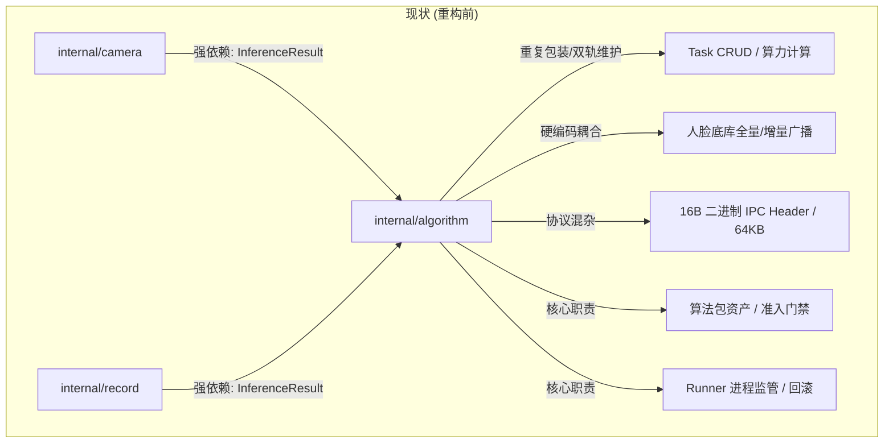
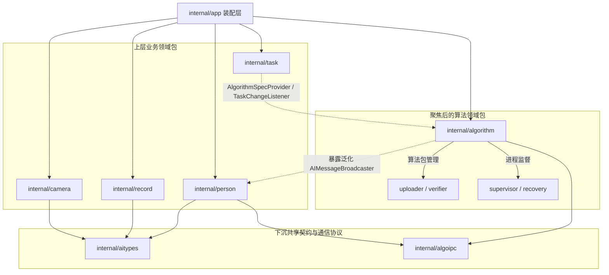

# Technical Design: internal/algorithm 模块瘦身与能力解耦

## 1. 架构目标与分层拓扑

### 1.1 现状问题分析
当前 `internal/algorithm` 处于“大杂烩”状态，导致跨层依赖错位与单包膨胀。



### 1.2 目标架构拓扑



---

## 2. 详细解耦与重构设计

### 2.1 Phase 1: 彻底清理 Task 职责
1. **持久化层 (`algorithm/store.go`)**：
   - 移除 `CreateTask`, `CreateTaskWithinBudget`, `GetTask`, `ListTasks`, `UpdateTask`, `DeleteTask` 等所有代理方法。
   - 彻底删除 `algorithm/store_task_test.go` 或将其断言合并进 `internal/task/store_test.go`。
2. **服务层 (`algorithm/service.go`)**：
   - 移除 `CreateTask`, `UpdateTask`, `DeleteTask`, `ListTasks`。
   - 保留接口实现：
     ```go
     // OnTaskChanged implements task.TaskChangeListener
     func (s *Service) OnTaskChanged(ctx context.Context, algorithmID string) { ... }
     
     // GetAlgorithmSpec implements task.AlgorithmSpecProvider
     func (s *Service) GetAlgorithmSpec(ctx context.Context, idOrName string) (*task.AlgorithmSpec, error) { ... }
     ```
3. **控制层与路由 (`algorithm/handler.go`, `internal/app`)**：
   - 从 `algorithm.Handler` 移除 `ListTasks`, `CreateTask`, `DeleteTask`。
   - 兼容路由 `/api/v1/algorithms/tasks`：
     - 在 `internal/app/router.go` 中，将该 group 直接委托注册至 `task.Handler`：
       ```go
       // 兼容旧端点
       legacyAlgoTasks := protected.Group("/algorithms/tasks")
       taskHandler.RegisterLegacyRoutes(legacyAlgoTasks)
       ```
   - 删除 `algorithm/requests.go`。

### 2.2 Phase 2: 提取公共 AI 推理数据契约 (`internal/aitypes`)
1. **新建 `internal/aitypes` 独立包**：
   - `model.go`：包含 `InferenceResult`, `ResultType`, `DetectionItem`, `ClassificationItem`, `PersonItem`, `FaceSubItem`, `FaceCandidate`。
   - 无任何其他内部业务依赖，支持极速轻量编译。
2. **重定向现有依赖**：
   - `internal/camera/stream_hub.go`：
     `type AIResultConsumer interface { ProcessInferenceResult(ctx context.Context, res aitypes.InferenceResult) error }`
   - `internal/record/service.go`：直接使用 `aitypes.InferenceResult`。
   - 在 `internal/algorithm/result.go` 中使用类型别名（`type InferenceResult = aitypes.InferenceResult`）保证渐进式平滑过渡。

### 2.3 Phase 3: 下沉 IPC 二进制通信协议 (`internal/algoipc`)
1. **新建 `internal/algoipc` 独立包**：
   - `protocol.go`：
     - 常量：`IpcMagic = 0x5A484C47`, `IpcVersion = 1`, `MaxIpcPayloadSize = 64 * 1024`。
     - 消息类型常量：`MsgResult = 7`, `MsgGallerySync = 10`, `MsgGalleryUpsert = 11`, `MsgGalleryDelete = 12`, `MsgGalleryAck = 13`。
     - 结构体：`IpcHeader`。
     - 函数：`EncodeIpcMessage(msgType uint16, seq uint32, payload []byte) ([]byte, error)` 与 `DecodeIpcHeader(data []byte) (*IpcHeader, error)`。
2. **测试与契约对齐**：
   - 将原 `internal/algorithm/ipc_contract_test.go` 的协议对齐测试迁移/链接至 `algoipc`，验证与原生 C++ 头文件 `native/include/Zhulong/ipc_protocol.hpp` 的魔数和结构体内存对齐。

### 2.4 Phase 4: 人脸底库广播逻辑解耦
1. **抽象泛化 IPC 发送器**：
   - `algorithm.Supervisor` / `RunnerProcess` 仅暴露通用消息发送通道：
     ```go
     type MessageBroadcaster interface {
         BroadcastMessage(ctx context.Context, msgType uint16, payload []byte) error
     }
     ```
2. **底库同步回归 `internal/person`**：
   - 将 `GalleryBroadcaster`、`GallerySyncItem`、`GalleryUpsertPayload` 迁入 `internal/person`。
   - 由 `person.GalleryBroadcaster` 消费泛化 `MessageBroadcaster`，按需把人脸数据打包为 `algoipc` 报文发送给 Runner。
   - `algorithm.Supervisor` 移除对 `GallerySyncProvider` 的强硬引用，改为通过通用的启动后钩子（`PostStartHook`）进行初始化调度。

---

## 3. 验收与质量验证策略

1. **单元测试与回归**：
   - 每个被拆离的包（`task`, `aitypes`, `algoipc`, `algorithm`）均自带独立单元测试。
   - 运行 `python3 native/scripts/build.py go test -race ./internal/...` 确保并发无竞态。
2. **HTTP API 契约验证**：
   - 验证 `/api/v1/tasks` 与 `/api/v1/algorithms/tasks` 表现完全一致。
3. **整体工程校验**：
   - 执行 `make check`，确保 API 文档（`make api-docs`）、代码格式、前端类型与端到端测试全部通过。
