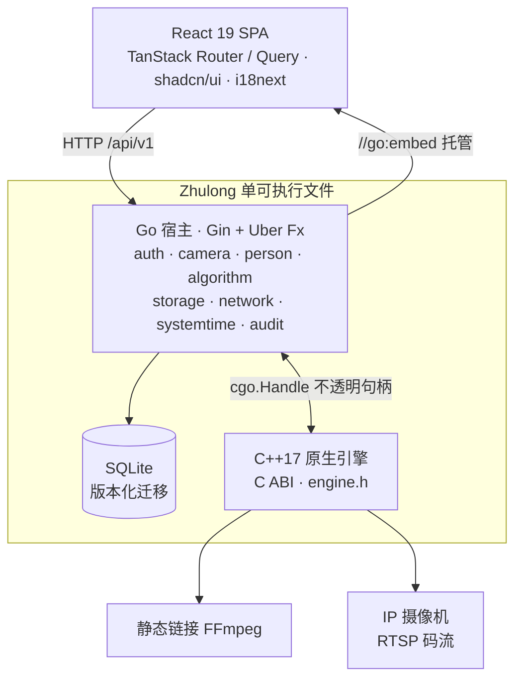

<div align="center">

# Zhulong 烛龙

**本地优先的边缘运维宿主 —— 一个可执行文件，内嵌控制台、数据库与原生推理引擎**


[简介](#简介) · [特性](#特性) · [架构](#架构) · [快速开始](#快速开始) · [配置](#配置) · [项目结构](#项目结构) · [开发](#开发) · [路线图](#路线图)

</div>

---

## 简介

Zhulong（烛龙）把四件事编译进**同一个二进制**：

| 组成 | 说明 |
| --- | --- |
| **Go 宿主** | Gin + Uber Fx 的业务应用，按业务域分包 |
| **内嵌控制台** | React 19 SPA，经 `//go:embed` 打包，浏览器直接访问 `/` |
| **版本化数据库** | SQLite + `golang-migrate`，启动时自动迁移，禁用 `AutoMigrate` |
| **原生引擎** | C++17 + 静态链接 FFmpeg，经单一 C ABI（`engine.h`）暴露 |

> **交付模型（方案 A）**：单个可执行文件，运行时**零 Node.js 依赖**，
> 只依赖宿主 Linux 的 C 运行时（glibc/musl）、线程库与厂商驱动。

设计取向是「本地优先」：设备在现场断网、无外网、无云端账号的前提下仍需完整可用，
因此数据落在本机 SQLite，凭据在本机加密，配置由本地 TOML 文件驱动。

## 特性

**边缘运维**

- **摄像头全生命周期** —— 主子流建模、AES-GCM 凭据加密落盘、正交状态机与探活调度
- **网络配置** —— 两阶段提交 + 看门狗回滚；`-reset-network` 提供带外紧急恢复
- **存储水位感知** —— `statfs` 探测外挂盘、双水位回差清理，防止写满边缘盘
- **媒体文件只读服务** —— 按相对路径取元信息与 RFC 7233 Range 字节传输；`os.Root` 内核级路径防护，服务端零解码（浏览器消费 CPU）
- **时间同步**与**操作审计** —— 审计由统一中间件记录，敏感信息仅在服务端日志留痕
- **单用户凭据认证** —— SQLite 凭据 + 内存会话 + Cookie

**视觉接入（原生引擎）**

- H.264 / H.265 **压缩码流**的 RTSP 探测与抓取，静态链接 FFmpeg
- 按需 CPU 解码流水线，产出 `HardwareFrame` 供原生 AI 消费
- 算法包生命周期管理与 Runner 进程监督

**工程**

- 统一响应信封 `{code, message, data, details?}` + 后端三语 i18n（`en` / `zh-Hans` / `zh-Hant`）
- Swagger 2.0 文档自动生成，随二进制提供
- Go 全量 `-race` 测试；原生 CTest 套件，可选 ASan/UBSan/TSan
- 前端测试跑在**真实无头浏览器**（Vitest browser mode + Playwright），不是 JSDOM

## 架构



三层之间由**跨层防爆门契约**约束：CGO 只经 `engine.h` 交互且绝不传 Go 指针、
C++ 异常绝不穿越 C ABI、包视图仅在同步回调期间有效。完整契约见
[`.trellis/spec/architecture.md`](.trellis/spec/architecture.md)。

## 快速开始

### 前置依赖

- Go 1.27.1 或更新
- Node.js 24 与 npm
- CMake 3.20 或更新
- 一个 C 编译器与一个 C++17 编译器
- Python 3.12 或更新（原生依赖准备与测试）；`curl`（冒烟测试）

### 构建

固定版本的 FFmpeg 源码需要**显式准备一次**（唯一联网步骤，带 SHA-256 校验）；
此后的原生构建全部离线：

```bash
make native-deps     # 一次性，下载并校验固定版本 FFmpeg
make build           # 前端 → C++ 静态库 → Swagger → 单个 Go 二进制
```

产物是 `build/Zhulong`。

### 运行

```bash
make run             # 构建后以仓库根的 config.toml 启动
# 或
./build/Zhulong
```

启动后：

| 入口 | 地址 |
| --- | --- |
| 控制台 | `http://127.0.0.1:8000/` |
| 健康检查 | `/api/v1/health` |
| API 文档（Swagger） | `/swagger/index.html` |

`make smoke` 会跑内置集成冒烟测试（健康检查、内嵌 SPA、API 404 隔离、Swagger）。

### 开发

```bash
make dev             # Air（Go 热重载）+ Vite dev server 一起启动
```

或分开跑：一个终端 `make run`，另一个终端 `make web-dev`。Vite 把 `/api` 代理到
`127.0.0.1:8000`，与仓库内 `config.toml` 保持一致。

## 配置

宿主启动时从**工作目录**读取 `config.toml`。配置是严格的：文件缺失、未知键、非法值
都会中止启动；文件内被省略的键使用内置默认值。

```toml
[http]
address = "127.0.0.1:8000"      # 内置默认是 127.0.0.1:8080

[logging]
development = false

[data]
directory = "./data"            # 存放 zhulong.db 与 camera.key

[network]
custom_script = ""              # 可选的厂商网络脚本

[algorithm]
target = "cpu"                  # 必须匹配算法包 manifest.json 的 platform.target
```

> **端口**：内置默认 `8080`（`app.DefaultConfig`），仓库内 `config.toml` 用 `8000`，
> Vite 代理跟随 `config.toml` —— 改端口需同步这两处。

除紧急恢复参数 `-reset-network`（绕过 Fx 依赖图，将主网口重置为维护 IP）外，
宿主没有任何启动开关：改配置请编辑 TOML 后重启服务。

## 项目结构

```
cmd/Zhulong/          入口：加载 config.toml，装配并运行
internal/
  app/                组合根：Fx 模块、路由挂载、启动/关闭顺序
  auth/ camera/ person/ algorithm/
  storage/ network/ systemtime/ audit/ mediafile/
                      各业务域，每个暴露一个 New*Components + RouteRegistrar
  database/           GORM + SQLite，内嵌版本化迁移
  engine/             唯一的 cgo 包，C ABI ↔ 原生 Go 类型转换
  httputil/ apperr/ httpmiddleware/
                      响应信封、类型化错误、业务无关中间件
  webui/              //go:embed all:dist
native/
  include/Zhulong/engine.h    唯一的公开原生头文件
  src/                C++17 引擎实现
  sdk/ profiles/ scripts/ tests/
web/                  React 19 SPA（pnpm）
.trellis/             开发规范、任务与工作流
```

## 开发

**规范先行。** 各类约定以 `.trellis/spec/` 为准（中文），按层组织；
`backend/index.md` 与 `frontend/index.md` 各带一份 Pre-Development Checklist。
动手写一个新包的代码前，先读对应规范。

```bash
make check           # 完整门禁：前端 lint/type-check/test + native-test + api-docs + go-check
make go-check        # gofmt + vet + go test -race ./cmd/... ./internal/...
make native-test     # CTest 套件（无需摄像头/网络，使用合成 fixture）
```

三个容易踩的坑：

- 任何（间接）依赖 `internal/engine` 的包**不能**直接跑裸 `go build`/`go test`/`go vet`，
  必须经 native wrapper（`make` 或 `python3 native/scripts/build.py go ...`）。wrapper 提供
  显式的静态 FFmpeg 库与**内容寻址**的 Engine 归档，避免 Go 的外部归档缓存掩盖原生改动。
- 改完 C++ 必须 `make native-build` —— Air 只监听 Go/TOML。
- **媒体目录软链部署约束**：若在 `mediaDir` 下使用符号链接部署，**链接目标必须使用相对路径**（`os.Root` 会严格拒绝绝对路径目标的符号链接，即使绝对路径最终落在根内亦会被拦截并返回 `422 MEDIA_PATH_ESCAPE`）。

工作用 Trellis 任务跟踪，详见 [`.trellis/workflow.md`](.trellis/workflow.md)（英文）。

## 路线图

**已实现**：`cmd/Zhulong`、`internal/app`、`database`、`engine`、`httputil`、`webui`、
`auth`、`camera`、`person`、`algorithm`、`storage`、`network`、`systemtime`、`audit`、`mediafile`，
均有实现与单元测试。

**尚未交付，也不作任何承诺**：

- 摄像头 CRUD 与 Go 侧订阅的完整链路、ONVIF、录像、预览传输
- 人员底库经 UDS 下发至 Runner 的热更新链路
- 算法推理结果的落库与事件派发
- MPP / RGA / RKNN 等硬件加速，以及目标板运行时
- C++ 解码/预处理流水线的完整交付（当前为按需解码）

**状态**：控制台基于 shadcn-admin 模板起步，目前**只有摄像头、审计日志与系统设置
（网络 / 时间 / 存储 / 外观）等页面接入了真实后端**，模板自带的其他页面（Apps、Chats、
Tasks、Clerk 等）尚未清理。

### 兼容性

早期宿主骨架在 macOS arm64 上验证通过（Go 1.27.1、Node 24.15.0、npm 11.12.1、CMake 4.4.0、
Apple Clang 17.0.0）。FFmpeg 接入链路在 Linux x86_64 上验证通过（GCC 14.2.0 —— 非最低版本要求、
CMake 3.31.6、Go 1.27.1）。Darwin 链接路径保留但未经 macOS 验证。

显式交叉编译 profile 受支持，产物必须落在 `build/targets/<name>/` 下，且**只允许编译、
不允许执行测试**：

```bash
make native-cross-build CROSS_PROFILE=<profile> CROSS_OUTPUT=build/targets/<name>/Zhulong
```

实际的目标链接与 RK3568 兼容性仍待匹配的工具链/sysroot 与板端实测证据。
详见 [`native/README.md`](native/README.md)。

## 许可证

[GPL-3.0](LICENSE)（GNU General Public License v3.0）

Copyright (C) 2026 niko

本程序是自由软件：你可以依据自由软件基金会发布的 GNU 通用公共许可证第 3 版
（或你选择的任何更新版本）的条款重新发布和/或修改它。

本程序基于「有用」的希望发布，但不提供任何担保；甚至不提供适销性或特定用途适用性的默示担保。
详见 GNU 通用公共许可证。你应该已随本程序收到一份许可证副本；若没有，见
<https://www.gnu.org/licenses/>。

**为什么是 GPL-3.0**：本项目**静态链接** FFmpeg（LGPL 2.1 或更新）。选择 GPL-3.0 后整份源码
都在 GPL 之下，LGPL 的重链接义务自动满足。第三方组件的完整清单、FFmpeg 的构建配置与
分发义务见 [`THIRD-PARTY.md`](THIRD-PARTY.md)。
